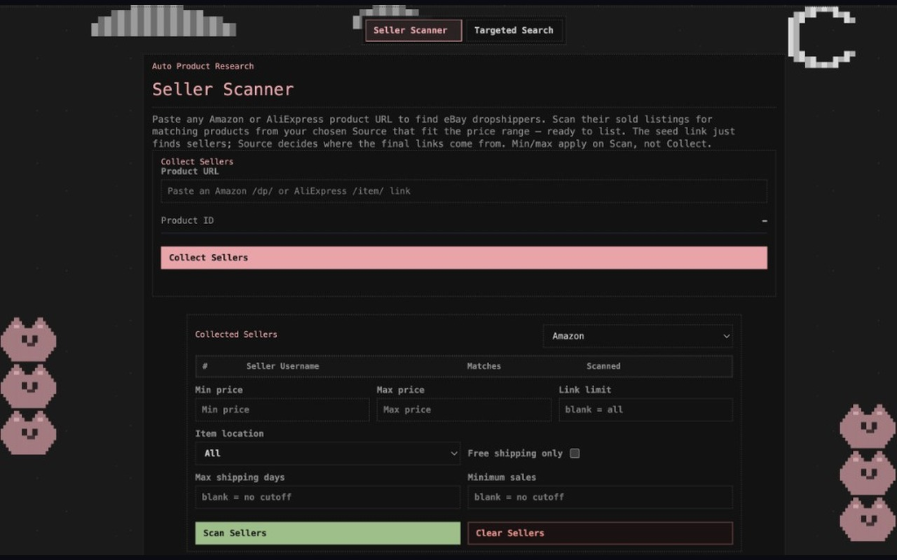

# Cat Dropper

A Chrome extension for researching products, creating marketplace listings, fulfilling orders, and tracking profit. Built as a side project for running that work between classes.

Live site: [catdropper.com](https://catdropper.com)

The application source stays in a private repository. This page is a public overview of the product.

## What it does

- **Research.** Find products that already sell and collect source links for similar items.
- **Auto Lister.** Turn source product links into eBay or Poshmark listings.
- **Fulfillment.** Work sold orders from the source side and keep a profit history.
- **Tracker.** Watch listed items for stock and shipping changes.
- **Store Optimizer and profit dashboard.** See what sold and how the store is doing.

Accounts, plans, and billing live on the Cat Dropper server. The extension is the signed-in app.

## Screenshots

